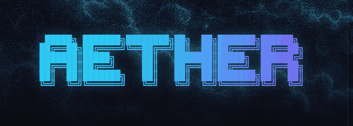
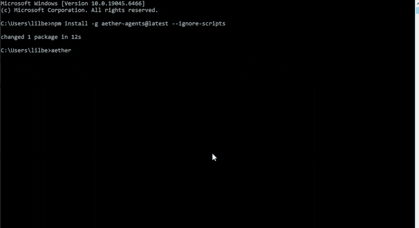

<div align="center">



# Aether Agent

**Build, test, and review from your terminal.**

An open-source coding agent that reads your repository, makes changes, and runs your checks.
Choose hosted models or local Ollama. Keep working in the same terminal.

[](https://github.com/AetherAI3/aether-agent/actions/workflows/ci.yml)
[](https://www.npmjs.com/package/aether-agents)
[](https://pypi.org/project/aether-agent/)
[](https://nodejs.org/en/download)
[](LICENSE)

[**Install**](#quickstart) · [**Sign in**](#2-sign-in) · [**Local Ollama**](#choose-your-model) · [Commands](#everyday-commands) · [Docs](#documentation) · [Contribute](#build-and-contribute)

</div>

<!-- SOURCE-0.3-WORKFLOWS:START -->

## Quickstart

Works on **Windows, macOS, and Linux**. Install [Node.js 24 or newer](https://nodejs.org/en/download), which includes npm, then open your terminal (PowerShell on Windows).

### 1. Install

```sh
npm install -g aether-agents@latest --ignore-scripts
aether --version
```

The npm package is **`aether-agents`**; the command is **`aether`**. Already installed? The same install command updates it. [Other install options ↓](#other-install-options)

### 2. Sign in

For hosted models, run:

```sh
aether auth login
```

Open the sign-in page shown in your terminal, enter the displayed code if asked, and approve access. The CLI opens your browser automatically when available; wait for **`✓ Logged in.`** before continuing.

```sh
aether auth status
aether models
```

`auth status` checks your sign-in; `models` lists the models available to your account. **Prefer local models?** Skip sign-in and follow [Local Ollama](#choose-your-model)—no Aether account required.

<details>
<summary>Browser did not open, or signing in over SSH?</summary>

```sh
aether auth login --no-browser
```

Open the printed URL on a device with a browser and enter the code. Keep the terminal running while you approve. If the code expires, run the command again.

For token-based automation, see the [authentication reference](COMMANDS.md#aether-auth-subcommand--credentials).

</details>

### 3. Run your first task

Move into your project folder (replace `your-project` with its path), then ask for a change:

```sh
cd your-project
aether agent --test-cmd "npm test" "fix the failing test"
```

Replace `npm test` with your project's test command. `aether agent "your task"` runs file tools and checks on your machine, with model-requested actions subject to permission checks. Inspect the result with `aether review`.

For interactive chat, run `aether`, then try `/help` or `/models`. With the default settings, signed-in chat uses the Cloud chat service; use **`aether agent "your task"`** for work in your local checkout.

### Other install options

<details>
<summary>Python / pipx</summary>

Requires **Python 3.10+, pipx, and Node.js 24+ with npm on PATH**. This installs a launcher for the same CLI:

```sh
pipx install aether-agent
aether-agent auth login
aether-agent --version
```

Use `aether-agent` in place of `aether` throughout this README. The launcher installs the CLI on first use if needed; `aether-agent self install` updates the managed CLI. [Python setup and troubleshooting](packages/pypi-cli/README.md)

</details>

[Download releases and view tags](https://github.com/AetherAI3/aether-agent/releases) · [Build from source](#build-and-contribute) · [Published and source versions](#versions)

### Need a hand?

| What you see | What to do |
|---|---|
| `node` or `npm` is missing, or Node is too old | Install [Node.js 24+](https://nodejs.org/en/download), reopen your terminal, and check `node --version` and `npm --version`. |
| `aether` is not found after installing | Reopen your terminal and check npm's global bin directory is on PATH: the `bin` subdirectory of `npm prefix -g` on macOS/Linux, or the prefix itself on Windows. With pipx, use `aether-agent`. |
| Browser login does not open | Run `aether auth login --no-browser` and use the printed URL and code. |
| Signed in, but requests still fail | Run `aether auth status`, then `aether doctor --live`. An old `AETHER_TOKEN` environment variable overrides a saved login; see [auth troubleshooting](COMMANDS.md#aether-auth-subcommand--credentials). |
| Unsure what is configured | Run `aether doctor` for local diagnostics or `aether help <command>` for usage. |

## What you can do

The features below describe the current `main` source. Check `aether --version` and [Versions](#versions) when comparing your installation; published packages can differ from source builds.

| Workflow | Start here |
|---|---|
| **Code and verify** | `aether agent "your task"` — search files, make edits, and run your checks. |
| **Chat and use your shell** | Run `!commands` between messages; open an interactive terminal on Linux. [Terminal guide ↓](#chat-and-terminal) |
| **Choose your model** | Hosted account models or local Ollama. [Model setup ↓](#choose-your-model) |
| **Continue your work** | Resume project sessions, review changes, and export redacted handoffs. [Commands ↓](#everyday-commands) |
| **Connect tools** | MCP servers, agent skills, and local development previews. [Command reference](docs/generated/commands.md) |
| **Use account agents** | Shared Online conversations and guided ATS workspace setup. [Account agents ↓](#account-agents-and-ats) |

<p align="center">
  
  <br />
  <sub>Interactive console → /help → /models</sub>
</p>

## What's new in v4.21.0

These source-build highlights require v4.21.0. The [live npm badge](#versions) shows the current published CLI.

- **Faster input:** described slash commands, Ctrl+R prompt search, and multiline editing with undo and yank.
- **More control over context:** pin files, inspect what reached the model, and run a trusted skill for one local turn.
- **Clearer task controls:** literal prompt files, read-only planning, and feedback when you decline a tool call.

[Full release notes](RELEASE_NOTES.md) · [Version and release status](#versions)

## Choose your model

| Hosted | Local Ollama |
|---|---|
| Sign in with `aether auth login`. | No Aether account required. |
| `aether models` shows your account's available models. | Use a model installed at your Ollama endpoint. |
| With `aether agent "your task"`, prompts and selected context go to Aether; tools and checks run in your checkout. | Inference stays at your configured endpoint, which defaults to loopback. |

For **local Ollama**, install and start [Ollama](https://ollama.com/), then run:

```sh
aether local pull qwen2.5-coder:7b --yes
aether local use qwen2.5-coder:7b --yes
aether setup --local
aether agent --local --test-cmd "npm test" "fix the failing test"
```

The pull command downloads the model. Choose a model that fits your machine and replace the test command for your project. Setup and model selection do not change your backend; keep **`--local`** on coding tasks to select Ollama explicitly.

If you set `OLLAMA_HOST` to a remote endpoint, prompts go there. Network tools have their own permissions.

<details>
<summary>Browse the offline model catalogue</summary>

<!-- MODEL-CATALOGUE:START -->
A dated, sanitized offline fallback snapshot is available as [HTML](docs/model-catalogue/index.html), [JSON](docs/model-catalogue/catalogue.json), and [Markdown](docs/generated/model-catalogue.md). It was generated at `2026-09-22T01:47:56.169Z` from Cloud public projection `model-catalogue-v1` with verified digest `sha256:f5f516625932d8932bfca221aa5dbf3eb1d7b415eba8dabe298da24b984c64f7`. Listed availability is not an account entitlement; use `aether models` while signed in.
<!-- MODEL-CATALOGUE:END -->

</details>

## Everyday commands

| Goal | Command |
|---|---|
| Open interactive chat and help | `aether`, then `/help` |
| Run a coding task in your checkout | `aether agent "your task"` |
| Plan without editing files (v4.21.0) | `aether agent --planning "your task"` |
| Continue a project session | `aether sessions` |
| Review changes and verification | `aether review` |
| Connect or diagnose tools | `aether mcp`, `aether skills` |
| Manage a local dev preview | `aether preview` |
| Check your environment | `aether doctor`, `aether pc map`, `aether pc doctor` |
| Configure the CLI | `aether settings` |
| Preview and approve a branch and PR | `aether ship` |

Use `aether help <command>` or the [complete command reference](docs/generated/commands.md) for flags and slash commands.

<details>
<summary>Prompt files and planning (v4.21.0), plus verification</summary>

Save a multiline specification in `task.md` and run `aether agent --prompt-file task.md`. You can also pipe UTF-8 text to `aether agent --prompt-file -`. The whole input is one literal coding task. [Input limits and flag conflicts](COMMANDS.md#aether-code-task--autonomous-coding-agent)

Planning permits only file reading, directory listing, and repository search; it skips worktree creation and verification. Use `--planning` with a task, or `/plan <topic>` in a local interactive session. Cloud chat refuses `/plan` because its tools execute on the server. Save a plan or execute a phase later through the explicit goal controls.

A completed check records its exit code. Changing the repository makes that verification stale until you run it again.

</details>

## Chat and terminal

Run your own commands between messages, then choose whether to share their output:

```text
!npm test
/shell-result
/shell-result send
```

`!commands` run locally with **zero model API calls**. Output streams into the console with an exit code. `/shell-result` lets you preview and edit the bounded attachment; `send` shares it with the model and `cancel` discards the draft. Shell and terminal output stays out of saved chat history and automatic hosted prompts until explicitly shared.

| Platform | Local shell | Interactive programs |
|---|---|---|
| **Linux** | Persistent Bash: keeps cwd, exports, and functions. | `/terminal python3` supports input and resize. Requires Python 3 and TTY input/output. |
| **macOS** | Persistent Bash: keeps cwd, exports, and functions. | Use an external terminal. |
| **Windows** | One-shot `cmd.exe` by default. Use `/shell-profile use powershell` for persistent cwd, environment values, and functions. | Use an external terminal. |

**Shell:** Ctrl+C cancels a command; `/shell-reset` starts fresh. Commands wait for an active model/tool turn to finish.
**Linux terminal:** Ctrl+] returns to chat; `/terminal-attach` reconnects; `/terminal-stop` ends it. Local tools pause while that terminal is running, including when detached.

<details>
<summary>Editing, history, context, and shell controls</summary>

| In the interactive console | Control |
|---|---|
| Browse described commands | Type `/`; arrows or Tab select, Enter inserts, Enter again runs. Escape restores your draft. |
| Write a multiline prompt | Ctrl+J adds a newline; Enter submits. Ctrl+_ undoes; Ctrl+Y restores killed text. |
| Search earlier prompts | Ctrl+R searches this workspace; type to narrow, Ctrl+R for older matches, Enter to insert, Escape to cancel. |
| Attach or remove a file | `/pin src/guide.md` and `/drop src/guide.md` |
| Inspect model context | `/context` shows the last turn; `/context next <task>` previews a draft. |
| Use one trusted skill | `/skill user/fix-ci Investigate the failing unit test` on a local model |

The editing shortcuts and picker require the raw terminal composer. Newlines appear as `⏎` with a line count. If your terminal sends LF for Enter, set `aether config set lfSubmits true`. `AETHER_NO_HISTORY=1` disables prompt history. [Composer details](COMMANDS.md#aether--interactive-repl)

Pinned files are read from the execution checkout, including its worktree when used. `/context` lists digests and omissions without file bodies; `/context content src/guide.md` explicitly previews admitted local content. Cloud chat cannot confirm local pin delivery. [Context limits](COMMANDS.md#context--limits)

A one-turn skill restores your normal defaults afterward and shows its digest and host tool limits. Busy, queued, line-input, `--no-skills`, and Cloud chat invocations are refused. [Skill details](COMMANDS.md#aether-skills-subcommand--inspect-trust-and-manage-agent-skills)

For shell attachments, use `/shell-result lines`, then `drop`, `replace`, `mask`, or `redact` before sending. Review the exact command, captured directory, exit status, and omitted bytes; redaction does not guarantee secret removal. A later shell command cannot change the staged attachment. For pipes and JSON sessions, `/shell-result send` is the explicit one-step send form.

On Windows, `/shell-profile list` shows installed shells and versions, `/shell-profile status` shows the active profile and cwd, and `/shell-profile use cmd` restores the compatibility profile. Switching or resetting discards state without replaying commands. PowerShell keeps its own syntax; Bash commands are not translated.

When declining a model-requested tool call, add a short instruction such as `Use the offline unit suite.` It is returned once with the failed result; the tool stays blocked. Enter skips the note and Escape cancels it. [Approval details](COMMANDS.md#aether-config-showgetset--local-settings)

</details>

Account-agent DMs use a separate console. [Full shell and Linux guide](docs/LOCAL_SHELL_SESSION.md) · [PC and browser guide](docs/pc-capability-plane.md)

## Account agents and ATS

Use your managed agents and shared Online conversations from the terminal:

```sh
aether agent list
aether agent chat
```

`list` and `show` report account readiness; `aether doctor --live` checks the same read-only Cloud contract. In-chat help lists controls for the selected agent and can refresh its shared conversation. A saved message counts as admitted only when Cloud confirms admission.

ATS is the trading adapter for account agents. `aether agent create ATS Atlas` starts guided workspace setup for memory, strategies, and data settings.

| Capability | Current status |
|---|---|
| Shared account agents and Online chats | Requires the matching Cloud adapter and account admission. |
| ATS workspace and strategy preparation | Local memory setup, native Nano compiler checks, and data-provider configuration. |
| Browser observation | Read-only view; requires a separately running Agent Browser runtime. |
| Market-data execution and orders | Production runtime wiring and managed-agent order execution are unavailable. |

ATS requires the separate Python engine and policy consent. This build does not yet provide model-controlled broker actions or automatic live orders. Setup and observation do not grant trading authority.

[Account agents and ATS guide](docs/ACCOUNT_AGENTS_AND_ATS.md) · [ATS policy](ATS_ACCEPTABLE_USE_POLICY.md) · [Release qualification](docs/releases/OPERATOR-PACKET-v4.20.0.md)

<!-- SOURCE-0.3-WORKFLOWS:END -->

## Web and remote viewing

[**Aether Code**](https://app.aethersystems.net/) is the browser coding app alongside Web Chat and Design Lab. It uses the same Aether account; the CLI also works independently with local Ollama. Coding sessions stay on their host, while managed agents share their Online conversations.

**Remote viewing (`aether rc`)** lets a browser or phone observe a redacted terminal run through a link or QR code. It requests a separate owner-scoped RC identity without operator device enrollment; viewers have observation access only.

<details>
<summary>Remote viewing qualification</summary>

Remote viewing is included in v4.20.0. A live Cloud viewer journey with Windows and Linux hosts and a phone viewer was recorded on 2026-10-06. An ordinary-account deployed journey still needs qualification. [Remote viewing status and controls](docs/REMOTE_VIEWING.md)

</details>

## Privacy and control

- **You choose the workspace.** File tools enforce its boundaries. Shell commands run with your user's permissions; the workspace directory is not an OS sandbox.
- **You control local execution.** Model tools in `aether agent "your task"` pass host permission gates. Running your own shell command does not authorize future model actions.
- **You choose what to share.** Hosted coding sends task context to Aether. Local Ollama uses your configured endpoint. Shell output requires explicit sharing; credentials and session records live outside the repository.
- **You review before publishing.** `aether ship` shows the branch, commit, destination, and PR plan before approval. `--yes` alone cannot authorize publication.

[Security policy and private reporting](SECURITY.md). Review redacted session exports before sharing them.

## Documentation

| Find help with | Guide |
|---|---|
| Sign-in and token automation | [Authentication](COMMANDS.md#aether-auth-subcommand--credentials) |
| Commands and configuration | [Command reference](docs/generated/commands.md) |
| Python launcher | [pipx setup and diagnostics](packages/pypi-cli/README.md) |
| Shell and Linux terminal | [Local shell guide](docs/LOCAL_SHELL_SESSION.md) |
| Account agents and ATS | [Setup, browser controls, and execution status](docs/ACCOUNT_AGENTS_AND_ATS.md) |
| PC and browser capabilities | [PC guide](docs/pc-capability-plane.md) |
| Remote viewing | [Status and controls](docs/REMOTE_VIEWING.md) |
| Project memory | [Memory guide](docs/project-memory.md) |
| Architecture and operations | [Docs directory](docs/) · [Production operations](docs/PRODUCTION_OPERATIONS.md) |

## Build and contribute

Build from source with Node.js 24+:

```sh
git clone https://github.com/AetherAI3/aether-agent.git
cd aether-agent
npm ci --ignore-scripts
npm run build
npm link --ignore-scripts
```

Start with [CONTRIBUTING.md](CONTRIBUTING.md) for the repository map, development workflow, and required checks. Bug reports and feature requests go to [GitHub issues](https://github.com/AetherAI3/aether-agent/issues).

<details>
<summary>Development checks</summary>

```sh
npm run typecheck
npm test
npm run smoke
npm run verify:production
npm run docs:check
npm run release:truth
npm pack --dry-run
```

The runtime bundles reviewed ATS adapter code and pinned browser/context dependencies. See the contributing guide before changing that dependency graph.

</details>

## Versions

| Install | Version | What it is |
|---|---:|---|
| npm `latest` | [](https://www.npmjs.com/package/aether-agents) | Published CLI; the badge resolves the live dist-tag. |
| PyPI `aether-agent` | [](https://pypi.org/project/aether-agent/) | Python launcher for npm `latest`, unless pinned or an existing CLI is on PATH. |
| `main` source build | **4.21.0** | See the [v4.21.0 notes](RELEASE_NOTES.md) and [operator packet](docs/releases/OPERATOR-PACKET-v4.21.0.md). |

[Release notes](RELEASE_NOTES.md) · [Release log](docs/releases/README.md) · [Releases and tags](https://github.com/AetherAI3/aether-agent/releases)

## License

**Apache-2.0** for the Agent and bundled ATS adapter. The paid ATS engine is a separate prerequisite. The license covers the code; the Aether name and hosted service have separate terms. [LICENSE](LICENSE) · [NOTICE.md](NOTICE.md).
